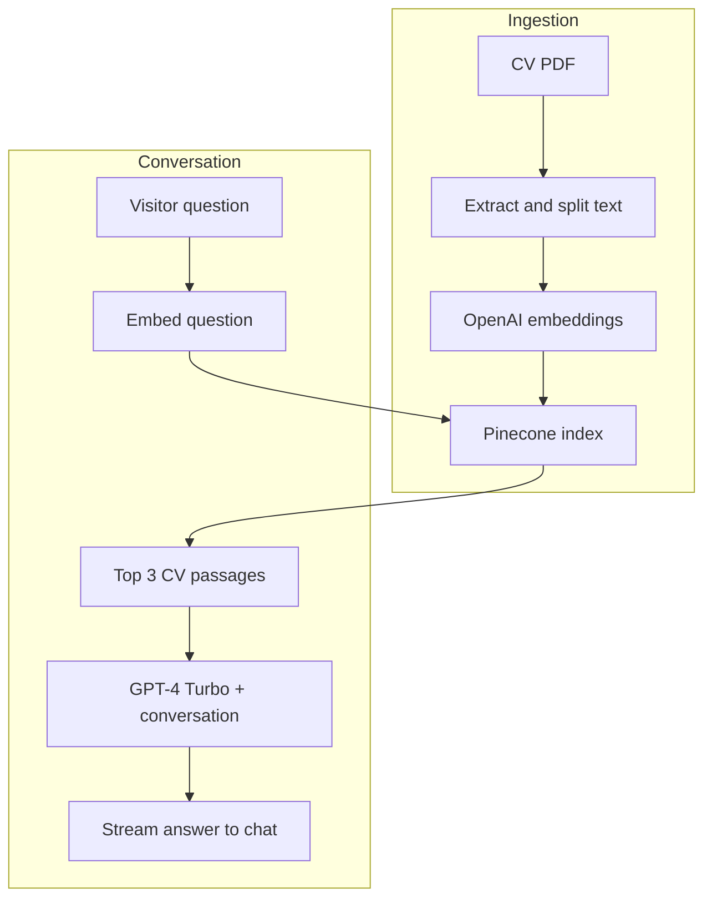

<div align="center">


### Turn a resume into an interactive conversation.

A personal AI assistant that retrieves information from a CV and streams answers about skills, experience, and projects.

<br />


<br /><br />

[Overview](#overview) · [Features](#features) · [Architecture](#architecture) · [Quick Start](#quick-start) · [Configuration](#configuration)

</div>

<br />

## Overview

Portfolio Chatbot gives visitors a conversational way to explore a developer's background.

The application retrieves relevant passages from an indexed CV and includes them in the model's context. Responses stream into a chat interface built with Next.js and React.

The assistant is configured to answer in the portfolio owner's voice. The interface identifies it as an AI-powered assistant.

<br />

## Features

| Feature | Implementation |
| :--- | :--- |
| **CV-based retrieval** | Searches indexed CV passages before generating an answer |
| **Streaming responses** | Streams model output into the chat using the Vercel AI SDK |
| **Personalized voice** | Configures first-person answers through the system prompt |
| **Suggested questions** | Starter prompts about skills, projects, and experience |
| **Conversation context** | Includes conversation history in the generation request |
| **PDF ingestion** | Extracts text, splits it into chunks, and stores embeddings |
| **Dark interface** | Gradient accents, translucent panels, and separate message styles |
| **Loading feedback** | Thinking indicator and disabled submission while responding |
| **Automatic scrolling** | Keeps the latest messages in view |

### Example questions

> What technologies do you work with?

> Tell me about your projects.

> What backend experience do you have?

> What does your CV say about your education?

Answers depend on the information included in the indexed document.

<br />

## Architecture

The application separates document ingestion from the chat request flow.



### Document ingestion

The ingestion script:

1. Reads `public/cv.pdf`.
2. Extracts text using `pdf-parse`.
3. Saves `cv_extracted.txt` for inspection.
4. Splits the text into overlapping chunks.
5. Generates an embedding for each chunk.
6. Uploads vectors and text metadata to Pinecone.

### Chat request

The `POST /api/chat` route:

1. Extracts the latest user message.
2. Generates an embedding for the question.
3. Retrieves the top three matching passages.
4. Adds the retrieved text to the system prompt.
5. Sends the conversation to `gpt-4-turbo`.
6. Returns a UI message stream to the React client.

Retrieval uses the latest question. Conversation history is passed to the generation model.

<br />

## Tech Stack

| Layer | Technology | Purpose |
| :--- | :--- | :--- |
| **Application** | Next.js 16 | App Router and chat API route |
| **Interface** | React 19 | Chat interface and client state |
| **Language** | TypeScript | Application and ingestion code |
| **Styling** | Tailwind CSS 4 | Layout and visual effects |
| **Chat integration** | Vercel AI SDK 6 | Chat hook and streamed responses |
| **Generation** | OpenAI GPT-4 Turbo | Conversational answers |
| **Embeddings** | LangChain OpenAI integration | Document and question embeddings |
| **Text splitting** | LangChain text splitters | Overlapping document chunks |
| **Vector storage** | Pinecone | Similarity search and metadata |
| **PDF extraction** | pdf-parse | CV text extraction |
| **Linting** | ESLint 9 | Static code checks |

<br />

## Quick Start

### Prerequisites

- A Node.js version compatible with Next.js 16.
- npm.
- An OpenAI API key with access to the configured models.
- A Pinecone API key.
- A CV PDF containing extractable text.

### 1. Clone and install

```bash
git clone https://github.com/ayoub-essarghini/portfolio-chatbot.git
cd portfolio-chatbot
npm install
```

### 2. Configure environment variables

Create `.env.local` in the project root:

```env
OPENAI_API_KEY=your_openai_api_key
PINECONE_API_KEY=your_pinecone_api_key
```

| Variable | Purpose |
| :--- | :--- |
| `OPENAI_API_KEY` | Embeddings and answer generation |
| `PINECONE_API_KEY` | Index creation, vector uploads, and retrieval |

Environment files are excluded by the repository's `.gitignore`.

### 3. Add your CV

Place your document at:

```text
public/cv.pdf
```

> Next.js publicly serves files in `public/`. Use a CV intended for public sharing, or change the ingestion path to a private directory before deployment.

### 4. Personalize the assistant

Update the owner's name and system instructions in:

```text
src/app/api/chat/route.ts
```

Update the visible name, initials, welcome text, and suggested questions in:

```text
src/app/page.tsx
```

### 5. Index the document

```bash
npx tsx --env-file=.env.local src/scripts/index-cv.ts
```

The script attempts to create the `portfolio-chat` Pinecone index if it does not exist, then extracts and uploads the CV content.

### 6. Start development

```bash
npm run dev
```

Open **http://localhost:3000**.

<br />

## Configuration

### Current settings

| Setting | Value |
| :--- | :--- |
| Pinecone index | `portfolio-chat` |
| Vector dimensions | `1536` |
| Similarity metric | `cosine` |
| New index cloud | `aws` |
| New index region | `us-east-1` |
| Chunk size | `500` characters |
| Chunk overlap | `50` characters |
| Retrieved passages | `3` |
| Generation model | `gpt-4-turbo` |
| Route duration setting | `60` seconds |

### Generation model

Edit `src/app/api/chat/route.ts`:

```typescript
model: openai('gpt-4-turbo'),
```

Choose a model available to your account and compatible with the SDK.

### Embeddings

Both the ingestion script and chat route create `OpenAIEmbeddings` without specifying a model name.

Keep their embedding configurations identical. The vector dimensions must match the Pinecone index.

### Index name

Update this constant in both files:

- `src/scripts/index-cv.ts`
- `src/app/api/chat/route.ts`

```typescript
const INDEX_NAME = 'portfolio-chat';
```

### Assistant personality

The system prompt controls identity, first-person phrasing, tone, and the response to missing information.

The current prompt asks the assistant to acknowledge when information has not been shared in the portfolio. This instruction does not guarantee that every generated answer will be grounded.

<br />

## Project Structure

| Path | Responsibility |
| :--- | :--- |
| `src/app/page.tsx` | Chat interface and message rendering |
| `src/app/api/chat/route.ts` | Retrieval and streamed generation |
| `src/app/layout.tsx` | Root application layout |
| `src/app/globals.css` | Global styles |
| `src/scripts/index-cv.ts` | PDF ingestion and vector uploads |
| `public/` | Public assets and expected CV location |
| `package.json` | Dependencies and npm scripts |
| `next.config.ts` | Next.js configuration |
| `eslint.config.mjs` | ESLint configuration |

The CV must be supplied during setup; `public/cv.pdf` is not included in the current repository.

<br />

## Available Commands

| Command | Purpose |
| :--- | :--- |
| `npm run dev` | Start development |
| `npm run build` | Create a production build |
| `npm start` | Start the built application |
| `npm run lint` | Run ESLint |
| `npx tsx --env-file=.env.local src/scripts/index-cv.ts` | Index the CV |

### Production

Configure the environment variables on your hosting platform and index the CV before serving requests.

```bash
npm run build
npm start
```

<br />

## Current Scope

- **Reindexing appends vectors:** existing chunks are not automatically replaced or removed.
- **No retrieval threshold:** the route requests the top three matches even for unrelated questions.
- **Temporary conversations:** no persistent conversation database is implemented.
- **No authentication or rate limiting:** these are not currently implemented in the chat route.
- **Text-based PDF extraction:** scanned documents require a separate OCR step.
- **No automated test suite:** the repository includes linting but no test script.

<br />

## Possible Improvements

- Stable document and chunk IDs for repeatable ingestion.
- Document namespaces and metadata filtering.
- Retrieval thresholds and source references.
- Incoming message validation.
- Rate limiting and request size limits.
- Clearer API error feedback in the interface.
- Ingestion and API integration tests.
- Configurable model and retrieval settings.
- Additional sources, such as project documentation.

<br />

## License

Licensed under the [MIT License](LICENSE).

<br />

---

<div align="center">

**Built by [Ayoub Es Sarghini](https://github.com/ayoub-essarghini)**

[Portfolio](https://www.ayoub-essarghini.com/) · [LinkedIn](https://www.linkedin.com/in/ayoub-es-sarghini-839973212)


</div>
